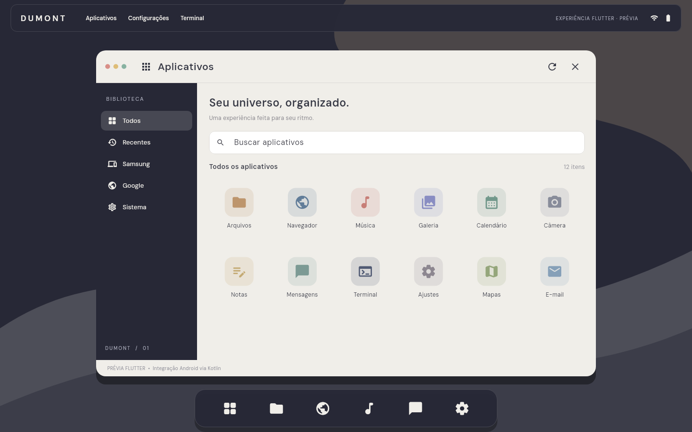

# DUMONT

**DUMONT OS · experiência Android em Kotlin e Flutter**

> **Estado em 17/10/2026:** Kotlin/Jetpack Compose Pilot v1.1 instalado
> historicamente no Galaxy Tab S9 FE; v1.2 compilada e testada, mas **não
> instalada**. Flutter Experience v0.1 em `experimental/flutter_dumont`:
> build Web/Android e 5 testes de widgets aprovados; **não instalada**.
> O DUMONT funciona sobre Android/One UI; não é ROM ou SystemUI própria.
>
> **Paleta 01 aprovada:** Baritone Blue `#272836`, Cloud Dancer `#F0EEE9`
> e Curds & Whey `#BCA483` como acento. Paletas v0.3 anteriores são históricas.
> Capturas Flutter são produzidas pelo renderizador em testes, não por câmera.


## Visão

Construir uma experiência de interface original e coerente para **Samsung Galaxy Tab S9 FE (SM-X510)** e **Samsung Galaxy A55 (SM-A556E)**, inspirada nos padrões de produtividade de um desktop, sem reproduzir marcas nem aplicativos proprietários da Apple ou alterar a segurança do Android.

### Regras visuais aprovadas

- **Marca:** DUMONT, em tipografia espaçada à esquerda da barra superior.
- **Desktop:** TopBar, janela de aplicativos, Dock inferior e Ghost invisível
  quando recolhido. Layout adaptativo para tablet e celular.
- **Paleta 01:** `#272836` para superfícies escuras, `#F0EEE9` para
  janelas claras/textos escuros e `#BCA483` para acentos discretos.
- **Fontes:** DM Sans para UI; Cormorant Garamond para editorial.
- **Flutter v0.1:** aplicativos e ícones ilustrativos, sem abrir apps reais.
  O Kotlin Pilot integra PackageManager e launch via APIs públicas Android.
- **Segurança:** sem alteração de HOME, One UI, Knox, SystemUI ou firmware.

**Prévia Flutter desktop — capturada em teste de renderização:**



[Tablet](experimental/flutter_dumont/test/goldens/tablet.png) ·
[Celular](experimental/flutter_dumont/test/goldens/mobile.png) ·
[Ghost](experimental/flutter_dumont/test/goldens/ghost.png)


## Alvos iniciais

| Equipamento | Código | Base auditada em 15/10/2026 | Implementação pretendida |
|---|---|---|---|
| Galaxy A55 | `SM-A556E` / `a55x` | Android 16, One UI 8.5, bootloader bloqueado | Layout compacto em retrato |
| Galaxy Tab S9 FE | `SM-X510` / `gts9fewifi` | Android 16, One UI 8.5, bootloader bloqueado | Desktop responsivo em paisagem |

Os dados da tabela são **observações históricas** feitas por comandos de leitura nos aparelhos. Precisam ser reconfirmados antes de implementar ou instalar qualquer build.

## Documentação

| Documento | Conteúdo |
|---|---|
| [PRD](docs/PRD.md) | Problema, usuários, escopo, requisitos e critérios de aceite |
| [TRD](docs/TRD.md) | Arquitetura Android proposta, restrições, dados, permissões e testes |
| [Fluxos](docs/FLUXOS.md) | Jornadas, navegação e estados operacionais |
| [Implantação](docs/PLANO_IMPLANTACAO.md) | Marcos, gates, QA, distribuição, rollback |
| [Design System](docs/DESIGN_SYSTEM.md) | Tokens, componentes, tipografia, responsividade e acessibilidade |
| [Governança](docs/GOVERNANCA.md) | PASS/FAIL/UNKNOWN, aprovação e proteção de dados |
| [Direitos de assets](docs/ASSETS_E_DIREITOS.md) | Origem e cuidados com imagens/marcas/fonte |
| [ADR-0001](docs/ADR-0001-ESTRATEGIA.md) | Decisão por launcher sem modificar ROM |
| [Relatório da sessão](docs/RELATORIO_SESSAO.md) | Histórico |
| [Status 17/10/2026](docs/STATUS_2026-10-17.md) | Evidências Kotlin, Flutter e deploy |
| [ADR-0012](docs/ADR-0012-FLUTTER-VISUAL-PROTOTYPE.md) | Arquitetura Flutter, testes e limites |

### Estrutura inicial (histórica)

```text
DUMONT/
├── README.md
├── docs/
│   ├── PRD.md
│   ├── TRD.md
│   ├── FLUXOS.md
│   ├── PLANO_IMPLANTACAO.md
│   ├── DESIGN_SYSTEM.md
│   ├── GOVERNANCA.md
│   ├── ASSETS_E_DIREITOS.md
│   ├── ADR-0001-ESTRATEGIA.md
│   └── RELATORIO_SESSAO.md
├── design/
│   ├── tokens.json
│   ├── tokens.css
│   └── paleta.svg
└── assets/mockups/  (pendente de upload)
    ├── dumont-tablet-e-a55-conceito.png
    └── dumont-desktop-conceito.png
```

### Estrutura Flutter atual

A implementação de UI e as capturas de teste ficam em
`experimental/flutter_dumont/`, com
`lib/main.dart`, `test/widget_test.dart`, `test/goldens/`, `android/`, `web/` e
`scripts/setup_fonts.sh`.

**Registro histórico da fase M2.** Código experimental Android em `feat/m2-android-foundation`; consulte [Fundação Android](docs/M2_FOUNDATION.md) e [piloto real Tab S9 FE](docs/M2_PILOTO_TAB_S9_FE_2026-10-16.md) e [estado do piloto Galaxy A55](docs/M2_PILOTO_A55_2026-10-16.md) e [auditoria de assinaturas APK](docs/M2_ASSINATURAS_APK.md) e [assinatura local estável do Pilot](docs/M2_ASSINATURA_ESTAVEL.md). Veja [estado verificável de 17/10/2026](docs/STATUS_2026-10-17.md)
para distinguir builds, commits e instalações.

## Referências técnicas

- [Android: interfaces adaptáveis](https://developer.android.com/jetpack/androidx/releases/compose-material3-adaptive)
- [Android: visibilidade de aplicativos](https://developer.android.com/training/package-visibility/declaring)
- [Android: acesso a arquivos com SAF](https://developer.android.com/guide/topics/providers/document-provider)
- [Android: multitarefa e back stack](https://developer.android.com/guide/components/activities/tasks-and-back-stack.html)
- [Pantone 2026 — Cloud Dancer](https://www.pantone.com/na/en-us/color-of-the-year/2026)

## Direitos, marcas e transparência

Este é um projeto independente, não afiliado a Samsung, Google ou Apple. Android, Galaxy, Google, nomes e logotipos de aplicativos pertencem aos respectivos titulares. **Referências Pantone** indicam inspiração de cor; HEX são aproximações de projeto. Mockups são ilustrações conceituais, não capturas de aplicativos em execução nos dispositivos.

## Licença — Apache 2.0

O código-fonte que vier a ser publicado e a documentação original deste repositório são disponibilizados sob a [Apache License, Version 2.0](LICENSE), salvo indicação expressa de outra licença. A Apache 2.0 permite uso, modificação e distribuição, inclusive comercial, mediante o cumprimento de suas condições.

**Escopo e marcas:** a licença de código não concede direito de uso sobre o nome e a identidade visual **DUMONT**. Mockups, imagens, fotografias, logos, ícones e outros materiais gráficos não estão abrangidos pela Apache 2.0, a menos que sejam explicitamente identificados como licenciados. Elementos e marcas de terceiros permanecem sujeitos aos direitos dos respectivos titulares. Há código Kotlin e Flutter; nenhuma versão final foi publicada em loja.

### Revisão de ergonomia v0.5

[ADR-0002 — Workspace, menu superior, Dock e acesso ao Termux](docs/ADR-0002-ERGONOMIA-MACOS.md). Etapa experimental; não altera a HOME padrão.

### DUMONT v0.6 — revisão da navegação

[ADR-0003 — barras translúcidas, catálogo completo e Dock por uso](docs/ADR-0003-DOCK-E-BARRAS-TRANSLUCIDAS.md).

### DUMONT v0.6.1 — barras alinhadas

[ADR-0004 — larguras idênticas, cor sólida e Dock essencial sem Termux](docs/ADR-0004-BARRAS-IGUAIS-DOCK-ESSENCIAL.md).

### DUMONT v0.7 — sistema, wallpaper e notificações

[ADR-0005 — barra de status, galerias e painel direito de notificações](docs/ADR-0005-STATUS-WALLPAPER-NOTIFICACOES.md).

### DUMONT v0.8 — Integração nativa Samsung / Android

[ADR-0006 — painel Galaxy, controles públicos, limites Knox e plano de widgets](docs/ADR-0006-INTEGRACAO-GALAXY-ONE-UI.md).

### DUMONT v0.9 — sidebar e harmonia cromática

[ADR-0007 — nova barra superior e painel lateral direito](docs/ADR-0007-DESIGN-SIDEBAR-V09.md).

### DUMONT v1.0-dev — correções de ergonomia

[ADR-0008 — Mural, catálogo classificável e limites Samsung DeX](docs/ADR-0008-ERGONOMIA-DEX-CATALOGO-MURAL.md).

### DUMONT v1.1 — Orchestrator e Samsung DeX

[ADR-0009 — política de abertura de apps, limites DeX e testes](docs/ADR-0009-ORCHESTRATOR-DEX-V11.md).

### Fluxo visual do Orchestrator
[ADR-0010 — retomada e Recentes no DeX](docs/ADR-0010-DEEX-VISUAL-RECENTES.md).

### Flutter Experience — v0.1

O código fica em [experimental/flutter_dumont](experimental/flutter_dumont/README.md).
Flutter 3.47.7: análise estática PASS (zero problemas), 5/5 testes PASS,
build Web release PASS e build Android ARM64 debug PASS.
Pacote `br.com.dumont.experience.preview`, **ainda não instalado**.
Aplicativos reais, notificações e bridge Kotlin são pendentes.
Consulte [ADR-0012](docs/ADR-0012-FLUTTER-VISUAL-PROTOTYPE.md),
[status](docs/STATUS_2026-10-17.md) e [Changelog](CHANGELOG.md).
