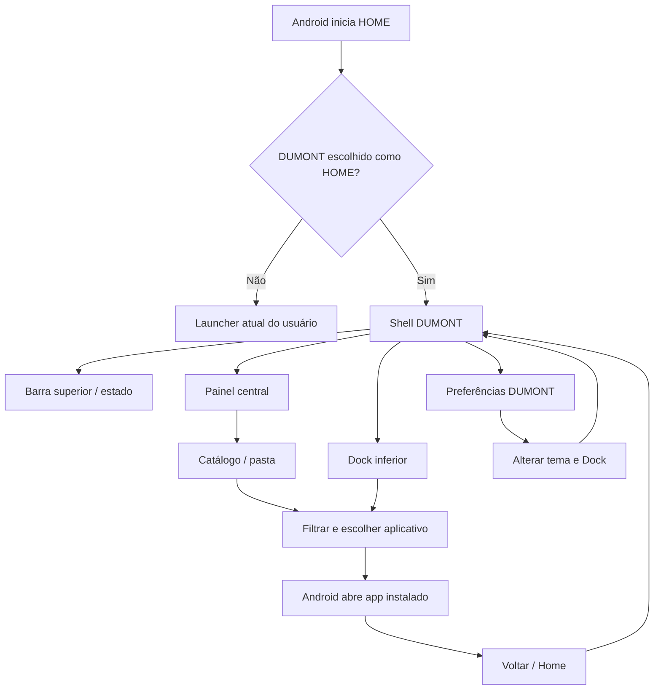
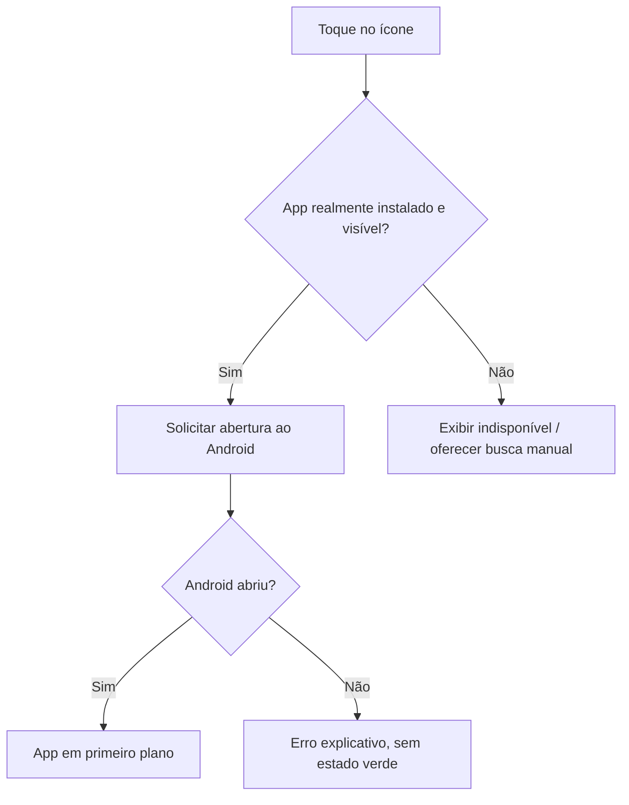
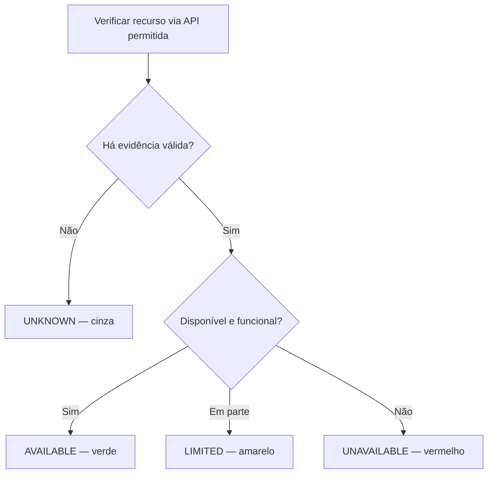
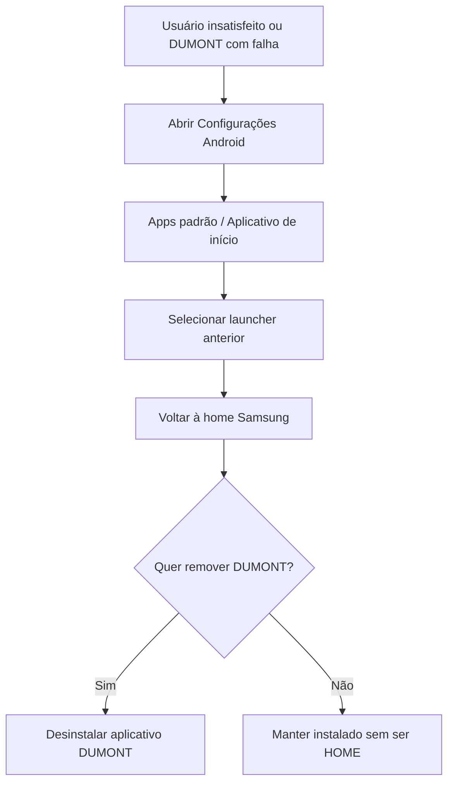

# FLUXOS — DUMONT OS v0.3

**Escopo:** UX e operações do launcher Android; representação de proposta, não funcionalidade entregue.

## 1. Arquitetura da navegação



## 2. Fluxo de primeiro uso

1. Usuário instala APK assinado em ambiente de teste, com confirmação explícita.
2. DUMONT explica que não substitui Android, não altera Knox e pode ser revertido.
3. Usuário consulta preview e opções de permissão; permissões opcionais não impedem navegação básica.
4. Android solicita escolha do aplicativo HOME quando cabível.
5. Se usuário não escolher DUMONT, app funciona apenas em modo demonstração, quando tecnicamente possível.
6. Se escolher DUMONT, abre tela adaptativa; Dock usa apps presentes sem inventar instalações.
7. Tutorial aponta como reverter para launcher anterior.

## 3. Fluxo principal — tablet

```text
┌──────────────────────────────────────────────────┐
│ DUMONT                                 ▣ • ▣      │  TOP BAR
├──────────────────────────────────────────────────┤
│                                                  │
│         ┌────────────────────────────┐           │
│         │ APLICATIVOS        BUSCAR   │           │
│         │                            │           │
│         │ [app] [app] [app] [app]    │           │
│         │ [app] [app] [app] [app]    │           │
│         │                            │           │
│         └────────────────────────────┘           │
│                                                  │
├──────────────────────────────────────────────────┤
│          [app] [app] [app] [app] [mais]          │  DOCK
└──────────────────────────────────────────────────┘
```

Barra superior e Dock inferior não são sidebars verticais. Área central tem papel de workspace. Apps externos abrem segundo modo nativo do Android.

## 4. Fluxo principal — smartphone

```text
┌───────────────────────────┐
│ DUMONT           ▣ • ▣    │  TOP BAR / CAMERA SAFE AREA
├───────────────────────────┤
│                           │
│       APLICATIVOS         │
│ ┌───────────────────────┐ │
│ │ [app] [app] [app]     │ │
│ │ [app] [app] [app]     │ │
│ │ [app] [app] [app]     │ │
│ │ buscar / rolar        │ │
│ └───────────────────────┘ │
│                           │
├───────────────────────────┤
│   [app] [app] [app] [+]   │  DOCK
└───────────────────────────┘
```

No A55, evitar grid ilegível e menus espremidos: a janela central é reposicionada conforme a altura disponível, com rolagem e teclado virtual sem encobrir ações.

## 5. Abrir aplicativo



## 6. Estados verde, amarelo, vermelho e desconhecido



Exemplo: link do Termux só fica verde se app estiver detectado e seu acionamento validado; ausência de API para confirmar Ubuntu resulta UNKNOWN, não verde.

## 7. Alterar Dock / tema

1. Abrir preferências do DUMONT.
2. Selecionar tema claro ou escuro; preview instantâneo.
3. Escolher apps já instalados e reordenar favoritos.
4. Persistir escolhas localmente.
5. Disponibilizar "Restaurar organização DUMONT" sem tocar nos dados dos aplicativos.

## 8. Abrir arquivos (P1)

1. Usuário escolhe **Arquivos** no workspace.
2. DUMONT solicita diretório/documento via seletor Android (SAF).
3. Usuário concede acesso ao item escolhido.
4. DUMONT exibe os documentos concedidos; não acessa arquivos fora do escopo.
5. Usuário pode revogar a autorização no Android.

## 9. Reversão e falha



Testar a reversão na prática antes de permitir distribuição beta.

## 10. Conteúdo da página de onboarding

Mensagem mínima: "DUMONT personaliza sua tela inicial. Android, segurança do aparelho e seus arquivos permanecem sob controle do sistema. Você pode retornar à tela anterior pelas configurações de aplicativos padrão."
